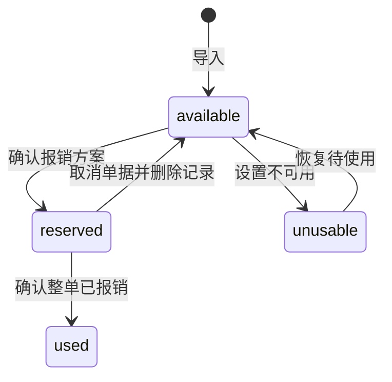

# 开发文档

本文面向接手维护、修改功能和打包发布的开发者，以当前代码为准。产品使用说明见 [README](../README.md)。

## 1. 项目定位与业务边界

本项目是个人发票库存与月度报销的本地桌面工具，使用 Python、Tkinter 和 SQLite，无 Web 后端、账号系统或云端数据库。

库存分两类：

| 分类 | 数据值 | 参与报销的方式 |
|---|---|---|
| 餐补 | `meal` | 根据天数和每日金额自动凑票 |
| 其他 | `other` | 用户勾选发票，按票面真实金额计入 |

不登记垫付用途、付款流水或额外凭证。每张发票只能整张使用一次，不拆分，不保留剩余额度。

金额定义：

```text
餐补目标 = 实际可报销天数 × 每日金额（默认 25 元）
整单目标 = 餐补目标 + 本单其他发票合计
整单实际金额 = 自动选出的餐补发票合计 + 本单其他发票合计
差额 = 实际金额 - 目标
```

允许餐补选票略多或略少，必须显示差额。其他发票不参与餐补凑票，也不会抵消餐补部分的差额。只报其他发票时，天数填 0。

以下规则必须保持：

- 生成方案只预览；确认方案后才预留发票。
- 改动目标或其他发票勾选后，旧方案失效，需重新生成。
- 打印、导出、确认已报销是独立操作。
- 命令返回成功不代表实际打印成功，必须由用户核对出纸并确认。
- 取消未报销单据会释放预留，并删除单据及关联明细；原件、备注、打印状态保留。
- 已报销单据不能取消，已使用发票不能恢复可用。
- 库存记录删除只删数据库记录，不删 PDF；已预留、已使用或关联报销单的发票不能删除。

## 2. 开发环境

### Windows

需要包含 Tcl/Tk 的 Python。项目使用 Python 3.10 及以上语法，CI 使用 Python 3.12；其他版本以实际依赖安装、测试和 EXE 自检结果为准。

```powershell
py -m venv .venv
.\.venv\Scripts\python.exe -m pip install -r requirements.txt
.\.venv\Scripts\python.exe app.py
```

无需激活虚拟环境。若 `python` 命令无输出但 `py` 正常，使用 `py` 或虚拟环境解释器的完整路径，确保安装与运行使用同一解释器。

为避免开发时读写真实库存，可指定独立数据目录：

```powershell
$env:INVOICE_MANAGER_DATA_DIR = Join-Path $env:TEMP 'invoice-manager-dev'
.\.venv\Scripts\python.exe app.py
# 不再需要覆盖路径时：
Remove-Item Env:INVOICE_MANAGER_DATA_DIR
```

### Linux / 云环境

需要 Python、Tkinter 和可用图形显示。GUI 测试不能只依靠语法检查，必须在真实显示器或虚拟显示器下运行。

已配置的云环境可使用：

```bash
DISPLAY=:99 PYTHONDONTWRITEBYTECODE=1 \
  /workspace/invoice-manager-env/bin/python -m unittest discover -s tests -v
```

`:99` 显示器须先启动；上述命令本身不会启动显示器。普通 Linux 安装可使用系统提供的 Xvfb/Xorg 等显示器，勿将某个云机器的路径作为应用依赖。

依赖分为 [requirements.txt](../requirements.txt) 与 [requirements-build.txt](../requirements-build.txt)：前者是应用运行依赖，后者额外安装 PyInstaller。依赖文件固定了直接依赖版本，传递依赖没有完整锁定。

## 3. 目录与模块职责

| 路径 | 职责 |
|---|---|
| [app.py](../app.py) | 唯一根目录源码入口，调用包内 `main()` |
| [invoice_manager/app.py](../invoice_manager/app.py) | 主窗口、库存查询、分类导入、备注和删除操作 |
| [workflow_panel.py](../invoice_manager/workflow_panel.py) | `MonthlyWorkflow` 方案生成及确认，`HistoryPanel` 历史列表 |
| [batch_view.py](../invoice_manager/batch_view.py) | 报销单清单、输出勾选、打印确认、整单完成和取消 |
| [database.py](../invoice_manager/database.py) | SQLite 表结构、迁移、查询与事务 |
| [read_invoice.py](../invoice_manager/read_invoice.py) | PDF 提取、字段解析、批量导入与原件保管 |
| [invoice_selector.py](../invoice_manager/invoice_selector.py) | 以整数分为单位寻找餐补发票组合 |
| [invoice_files.py](../invoice_manager/invoice_files.py) | PDF 定位、命名、无损 ZIP 导出、打印副本及系统打印命令 |
| [runtime_paths.py](../invoice_manager/runtime_paths.py) | 源码与 EXE 模式的数据、资源路径 |
| [ui_widgets.py](../invoice_manager/ui_widgets.py) | 24 像素勾选图标 |
| [tools/desktop_entry.py](../tools/desktop_entry.py) | EXE 入口和隔离自检 |
| [tools/build_windows.py](../tools/build_windows.py) | 独立构建环境、Tcl/Tk 收集、EXE 验证及输出更新 |
| [tools/windows_print.ps1](../tools/windows_print.ps1) | Windows 系统打印对话框与 .NET 打印组件 |
| [tests/](../tests/) | 单元测试和真实 Tkinter 交互回归 |

界面模块调用数据库与文件服务，不应直接拼接 SQL。添加新功能时先确定数据与状态规则，再接入界面，避免让界面缓存成为唯一数据来源。

导入和打印使用后台线程与队列；Tk 控件操作和用户确认在主线程完成。不要在工作线程中更新控件或销毁 Tk 对象。

## 4. 数据位置与备份

`data_directory()` 的优先级：

1. 设置了 `INVOICE_MANAGER_DATA_DIR`：使用指定目录。
2. EXE 模式：使用 `sys.executable` 同级的 `data/`。
3. 源码模式：使用仓库根目录。

数据目录内：

```text
data-directory/
  invoices.db        # 库存和报销历史
  managed_pdfs/      # 保管的原始 PDF
  invoices/          # 可选：旧版原始 PDF 位置
```

`resource_path()` 用于只读程序资源：源码模式查找 `tools/`，冻结模式查找 PyInstaller 的 `sys._MEIPASS`。不能把数据库写入 `_MEIPASS`，单文件 EXE 的临时解包目录不持久。

备份前关闭程序，一起复制 `invoices.db` 和 `managed_pdfs/`；若仍有旧路径文件，也复制 `invoices/`。源码迁移到 EXE 时，将它们复制到 EXE 同级 `data/`。更新 EXE 不替换数据目录，不自动合并两份数据库。

`original_path()` 优先读取数据库路径，缺失时尝试当前数据目录中的保管副本和旧发票目录，兼容跨电脑迁移。数据库没有对应记录的保管 PDF 不会自动变成库存，需要重新导入。

## 5. 数据库模型与迁移

### invoices：发票库存

| 字段 | 含义 |
|---|---|
| `invoice_number` | 主键，内部去重标识 |
| `invoice_code` | 传统发票代码；数电发票为空 |
| `invoice_serial` | 真实发票号码；旧记录可能为空，显示时回退主键 |
| `total_amount_fen` | 价税合计，整数分 |
| `invoice_date` | ISO 日期文本 |
| `buyer` / `seller` | 购买方 / 销售方 |
| `file_path` | 保管副本路径，旧数据可能是原文件绝对路径 |
| `category` | `meal` 或 `other` |
| `is_printed` | 0 / 1，独立于使用状态 |
| `status` | `available`、`reserved`、`used`、`unusable` |
| `remark` | 自由备注 |

数电发票使用 20 位号码作为主键；传统发票使用 10/12 位代码与 8 位号码拼接为内部主键。不要把传统票仅按 8 位号码去重，不同代码下可能出现相同号码。界面显示真实号码及代码，导出 PDF 名使用真实号码。

### reimbursement_batches：报销单

| 字段 | 含义 |
|---|---|
| `id` | SQLite 整数主键，未声明 AUTOINCREMENT，不应当成永久业务流水号 |
| `reimbursement_month` | `YYYY-MM` |
| `work_days` | 0～31 的整数 |
| `daily_allowance_fen` | 非负整数分 |
| `other_amount_fen` | 创建时其他发票金额快照 |
| `status` | 表结构允许 `reserved`、`used`、`cancelled` |
| `created_at` | SQLite 默认 `CURRENT_TIMESTAMP`，未进行本地时区转换 |

当前取消流程直接删除报销单，不创建一条新的 `cancelled` 历史记录；该状态值为兼容旧表保留。

### reimbursement_items：整单关联

`(batch_id, invoice_number)` 为联合主键，分别关联报销单和发票。不保存拆分金额，一条关联代表整张票。

### 迁移方式

`init_db()` 使用 `CREATE TABLE IF NOT EXISTS` 和 `PRAGMA table_info` 检查，按需添加：

- 发票的 `category`，默认 `meal`；
- 发票的 `invoice_code`、`invoice_serial`，默认空文本；
- 报销单的 `other_amount_fen`，默认 0。

目前没有独立迁移版本表。新增字段须兼容已有数据，并验证首次迁移、重复调用、备注与状态保留。不要通过删除数据库完成升级。

### 事务与约束

`create_reimbursement_batch()` 使用 `BEGIN IMMEDIATE`，重新确认每张票仍为待使用，检查预览时记录的分类，预留、写关联和保存其他金额快照在同一事务内完成。

`finish_reimbursement_batch()` 仅处理待报销单据：完成则整单标记使用，取消则释放发票、删除关联与单据；部分失败全部回滚。

`update_category_batch()`、`delete_invoices()` 等批量操作也须保证全部成功或全部回滚。SQLite 外键不是全局自动开启的；新增写连接涉及关联表时需显式启用并验证约束。

## 6. 导入与自动凑票

### 导入管线

```text
选择餐补/其他入口 → 逐文件解析 → 验证必要字段
→ 保存 managed_pdfs/<内部标识>.pdf → 按标识插入或跳过重复记录
→ 刷新库存和其他发票候选列表
```

解析先使用 pypdf 布局文本；字段不完整或提取失败时，使用 PyMuPDF 备用提取。选择一个字段最完整的提取结果，不跨提取器拼接不同字段。

必要字段为发票身份、日期、购买方、销售方和价税合计。字段不全时应返回缺失字段，不能根据上传文件名猜金额或公司。无文字扫描件尚无内置 OCR。

金额使用 `Decimal`，保存时转整数分，不使用二进制浮点累计报销金额。金额识别优先匹配“小写”合计标记，不能把未税金额、税额当作价税合计。

同一发票改名后再次导入仍跳过，保留原分类、备注和状态；可修复文件路径。单个文件失败不影响其他文件。数据库事务与文件系统复制不是一个原子事务，失败时可能留下未入库 PDF，不能因此直接批量删除保管目录。

### 凑票算法

`select_invoice_combination(invoices, target_fen)`：

- 只考虑 `meal + available + 正金额`；
- 按日期、内部标识排序；
- 用“合计金额 → 发票下标组合”的动态规划保存候选；
- 每轮使用快照，保证一张发票不会被重复加入；
- 优先最小金额绝对差，其次张数更少，再按排序后的组合稳定选择；
- 目标金额必须为正整数分；没有候选时返回空列表。

只有其他报销、餐补目标为 0 时，界面跳过餐补算法。算法状态量随可达金额增多，尚未为大规模库存提供专用性能保障；扩展时需测量真实耗时，不能用近似算法替换后仍声称一定找到精确最优组合。

## 7. 界面与业务状态

主窗口使用三个页签：本月报销、发票库存、报销历史。方案和报销单明细嵌入主窗口。备注编辑、删除记录和取消报销单使用弹窗，其余关键状态通过页面内确认操作完成。



这是主报销流程示意，底层接口还支持未关联报销单的部分人工状态调整。任何已关联有效单据的状态调整必须通过整单事务，已使用状态不能回退。

两种“选择”不要混用：

- 库存行高亮：打开原 PDF、修改备注、批量分类或删除。
- 发票复选框：其他发票是否加入新方案，或报销明细中哪些票用于打印/导出。

改变输出勾选不改变已创建单据的组成。开始打印时保存所选号码快照，之后确认只更新这次提交的票，不能使用用户后来改变的勾选集合。

## 8. 打印与导出

### 打印管线

1. 在临时目录生成 A5 横向 PDF，5 mm 边距、等比例完整缩放。
2. 每张发票一页，使用 200 DPI 灰度图；多页原票拒绝自动打印并提示核对。
3. Windows 生成 PNG，经 PowerShell 的 STA 进程启动 .NET `PrintDialog`；脚本内置到 EXE，无需手动运行或安装 SumatraPDF。
4. 打印组件核对所选打印机的 A5 能力，设置横向、黑白并提交；Linux/macOS 使用 CUPS `lp`。
5. 系统取消或命令失败不标记打印。Windows 取消返回码为 2。
6. 命令成功后仍须点击“全部实际打印成功”，才更新打印状态；不改变使用状态。

`print_command(pdf, sumatra=None)` 仍有显式传入 Sumatra 路径的兼容分支，当前界面默认不使用该分支。排查时优先沿实际原生 Windows 路径调查。

### 导出规则

ZIP 内是原始 PDF 字节内容，不能使用灰度打印副本代替。单文件名：

```text
真实发票号码_销售方名称_真实金额.pdf
```

压缩包名：

```text
2026-10应报销：100实际报销：90差额-10.zip
```

使用全角冒号适配 Windows。包名的应报销额使用整单目标，实际额使用本次勾选的发票合计；只导出部分票时，不会自动缩小目标。公司名中的非法字符替换为下划线，小数去掉无意义尾零。

`export_zip()` 检查命名冲突和缺失文件，用临时 ZIP 完成后再替换目标，禁止覆盖原始 PDF。不同传统代码的票可能拥有相同真实号码；若最终文件名也相同，当前行为是报告冲突，不能静默覆盖。

## 9. 测试与回归

```powershell
.\.venv\Scripts\python.exe -m unittest discover -s tests -v
```

| 测试文件 | 主要覆盖 |
|---|---|
| `test_workflow.py` | 主流程、后台导入、过期方案、状态回滚 |
| `test_categories.py` | 两类库存、迁移、混合报销、全选与大号勾选 |
| `test_inventory_actions.py` | 弹窗备注、删除确认、保留原件与关联保护 |
| `test_parsing.py` | 传统票、乱码备用提取、身份去重及金额 |
| `test_outputs.py` | 无损导出、打印文件规格、取消/失败/成功确认、打开 PDF |
| `test_runtime_paths.py` | 源码与冻结路径、数据覆盖目录 |
| `test_windows_build.py` | Tcl/Tk 与 zipfs、EXE 自检、锁定旧程序时的更新 |

测试通过替换 `database.DB_PATH` 使用临时数据库，不读写真实库存。部分回归依赖仓库已有发票样本；不要在没有替换方案时删除 `invoices/`。

Tk 测试需要图形显示，打印命令使用模拟，不会发真实打印任务。自动测试通过不等同于所有 Windows 版本、驱动、打印机均已验证。真实票据仅在本地临时目录验证，提交回归用合成文本或合成 PDF，勿上传私人附件。

## 10. Windows EXE 构建与发布

```powershell
.\build_windows.bat
# 或
py tools/build_windows.py
```

流程：

```text
创建/复用 .build-venv → 安装打包依赖
→ 从 Tcl/Tk 自身定位库并导出 zipfs → PyInstaller 单文件构建
→ 实际启动 EXE 自检 → 更新 dist 输出
```

构建主机必须是 Windows，Linux 上不直接生成 Windows EXE。资源数据目标固定为 `_tcl_data` 和 `_tk_data`，不能只复制 Tk DLL，忽略 Tcl 脚本目录。虚拟库通过 Tcl 文件系统复制成普通文件，并保持到 PyInstaller 完成。

`tools/desktop_entry.py --self-check <结果路径>` 检查 SQLite、Tk 窗口、PDF 依赖、A5 副本和打印脚本。冻结后由构建脚本实际启动 EXE，要求 60 秒内生成本次结果，且数据目录位于 EXE 同级，才接受产物。

构建中间文件在 `build/verified-output/`。用户应取构建完成时打印的 `dist/` 路径，不以 PyInstaller 单独显示的“Build complete”判断最终更新成功。

旧 `dist/InvoiceManager.exe` 被 Windows 占用无法替换时，已验证的新程序另存为带时间和编号的 EXE。不要自动终止用户程序，也不要删除数据目录。新旧 EXE 位于同一 `dist/` 时使用相同的 `data/`；先退出旧程序再启动新版。

[GitHub Actions](../.github/workflows/build-windows.yml) 在相关代码推送到 main 或手动触发后，使用 Windows + Python 3.12 构建，运行应用测试及冻结自检，成功后上传 `InvoiceManager-Windows-x64`。保存代码或推送不等于构建成功，应以该次 Actions 结果为准。

## 11. 常见故障

| 现象 | 排查与处理 |
|---|---|
| `python` 无输出，`py` 正常 | 使用 `py` 或虚拟环境完整路径；不要在不同解释器间混装依赖 |
| `No module named fitz/pymupdf` | 用运行程序的同一解释器安装 `requirements.txt` |
| EXE 缺少 `_tcl_data` | 更新构建脚本并重打包，检查日志 Tcl/Tk 路径和显式资源收集；不要删除数据 |
| Tcl/Tk 是 `//zipfs:/...` | 属于 Tcl 虚拟路径，需由 Tcl 导出，不应仅凭普通路径不存在就要求重装 Python |
| 构建 WinError 5 | 关闭旧 EXE 和报错窗口；新版构建会尝试另存，按最终路径取文件 |
| 导入失败 | 查看缺失字段，区分传统票、文本乱码、扫描图片、损坏 PDF；不能以文件名补写财务金额 |
| 打开原 PDF 无反应 | 区分勾选与行选择，检查保管副本；Windows 没有文件关联时设置默认 PDF 阅读器 |
| 打印失败或取消 | 查看页面具体错误、系统打印机和 A5 驱动支持；不把命令提交当成实际出纸 |
| GUI 测试不能连接 `:99` | 先恢复虚拟显示器，不将零 GUI 验证当成通过 |

## 12. 修改约定

- 金额保持 `Decimal` 或整数分，SQL 使用参数化查询。
- 数据结构改动放在 `database.py`，补迁移和重复初始化测试。
- 方案确认必须重新检查库存状态与分类，不能只信任预览缓存。
- 有关联数据的批量修改保持事务性，并覆盖中途失败回滚。
- 不擅自清空数据库，不因重构移动数据目录，不将个人票据加入打包资源。
- GUI 改动验证点击、选择和实际按钮可见性；文案保持简短，长说明留在文档。
- 修改应用包、构建入口或资源路径时，同时检查源码启动与冻结自检。
- 本项目当前协作约定为修改并验证后提交、推送；不强推覆盖他人的远端提交，构建状态另行核对。
